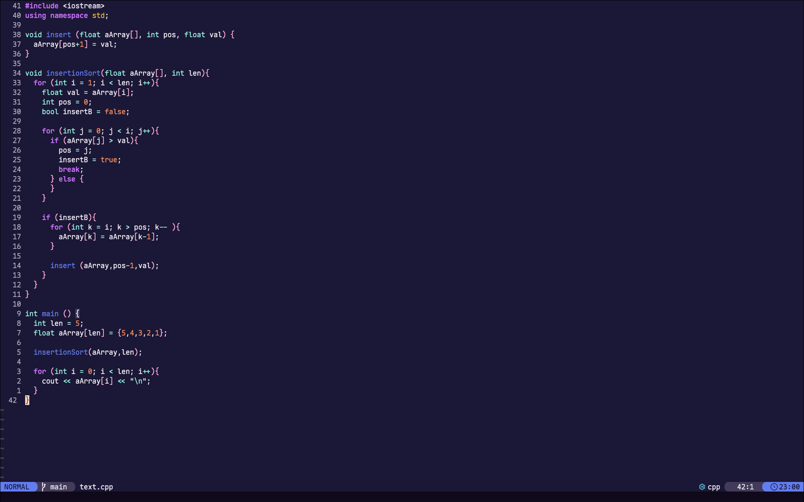
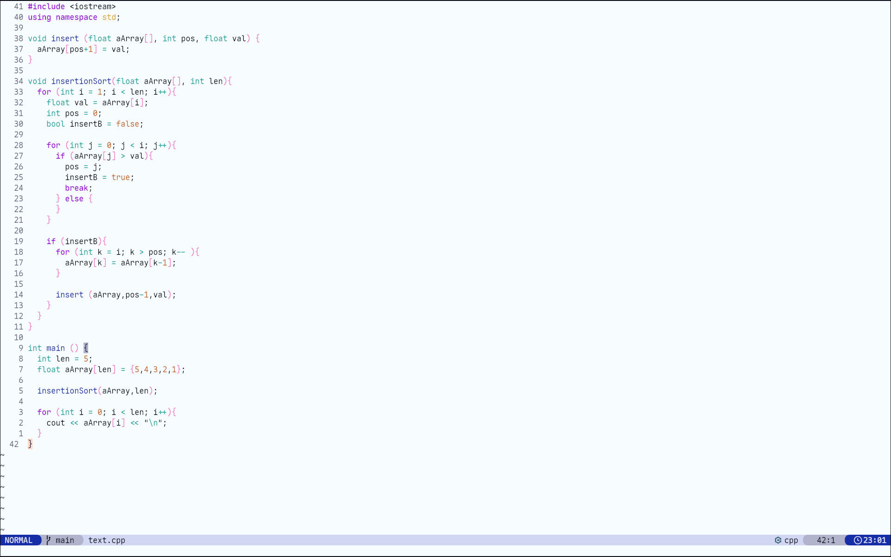

>[!WARNING]
>This repo is a mirror of [Codeberg](https://codeberg.org/nekomi_ch/FujiIdol.nvim)
>Please check source repo for issues and contribution

# FujiIdol.nvim

[Neovim port](https://github.com/neovim/neovim) for the [FujiIdol](https://codeberg.org/nekomi_ch/FujiIdol) color scheme

## Previews

### NekomiNight



### NekomiSky



## Installation

**Lazy.nvim:**
```lua
{
  	url = "https://codeberg.org/nekomi_ch/FujiIdol.nvim.git",
    name = "FujiIdol"
    config = function()
		vim.cmd("colorscheme FujiIdol")
			require("FujiIdol").setup({
				variant = "night",
                -- "sky" also available
                -- planned to be able to switch to "rose" and "hail"
			})
	end
}
```

## Plugins Available

- [Cmp](https://github.com/hrsh7th/nvim-cmp)
- [LuaLine](https://github.com/nvim-lualine/lualine.nvim) 
- [Telescope](https://github.com/nvim-telescope/telescope.nvim)
- [Which-key](https://github.com/folke/which-key.nvim) 


## Disclaimer

It is usable, but there are definitely more plugins and other types that could to be highlighted, 
you can request a plugin at Issues tab or by contacting me on my [discord](https://discord.gg/CXYmrSWeZX) server.

## Acknowledgements

It is based on the style guide underlined by [Catpuccin](https://github.com/catppuccin/catppuccin/blob/main/docs/style-guide.md)
and file structure inspired by [Vague](https://github.com/vague-theme/vague.nvim/tree/main) and [rose-pine](https://github.com/rose-pine/neovim/tree/main) theme.
